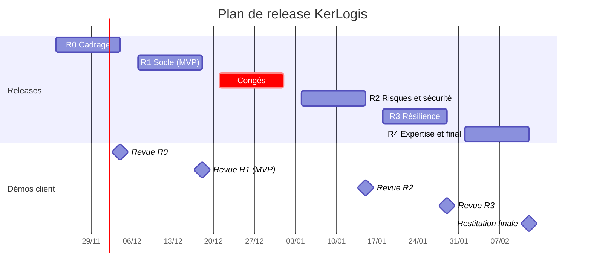

# SAE KerLogis – Analyse de risques et maquette d'infrastructure

Dépôt de l'équipe **BreizhOps Conseil** pour la SAE R5 (parcours **PilPro**).

Notre client, KerLogis (logistique et transport, Brest / Lorient, bientôt Rennes), doit prouver à un client grand compte et à son assureur qu'il maîtrise ses risques cyber et qu'il sait reprendre son activité après un incident. On travaille en Kanban, par releases de deux semaines, avec une démo client à la fin de chacune.

## L'équipe

| Membre | Rôle principal | Coordination du flux |
| --- | --- | --- |
| Yolan | Sécurité plateforme / réseau, étude financière (R3–R4) | R0, R4 |
| Melvin | Référent EBIOS RM | R3 |
| Elouan | Référent technique (Proxmox, sauvegardes, supervision) | R2 |
| Benjamin | Référent documentation, étude financière (R2) | R1 |

Le détail des rôles par release et la répartition des stories sont dans le [dossier de cadrage](docs/cadrage/dossier-cadrage-R0.md#0-léquipe-prestataire).

## Planning



Dates provisoires, à recaler sur l'emploi du temps.

**MVP (R1)** : le WMS (Odoo + PostgreSQL) tourne sur Proxmox, l'administration se fait avec des comptes nominatifs + MFA, il est sauvegardé chaque nuit avec PBS et la restauration est testée et chronométrée. Ateliers EBIOS 1 et 2 livrés.

## Organisation du dépôt

```
backlog/              Product Backlog versionné (v0 = R0), CSV + JSON
docs/cadrage/         Analyse de la demande, parties prenantes, story map, DoD, Kanban, plan de release
docs/ebios/           Ateliers EBIOS RM 1 à 5, tableau de risques, plan de traitement
docs/technique/       Procédures (installation, restauration, exploitation) et schémas draw.io
docs/etude-pilpro/    Étude financière : sur site vs cloud, Rennes, pics de saison
gestion-projet/       Journal de bord, comptes rendus PO, release notes, mails
scripts/              Script d'initialisation du tableau GitHub Projects
```

## Fonctionnement Kanban

- Tableau : GitHub Projects du dépôt, partagé en lecture avec le PO.
- Colonnes : À faire → Analyse (WIP 3) → En cours (WIP 3) → À vérifier (WIP 2) → Terminé, + étiquette `bloqué`.
- Classes de service : `expedite`, `date-fixe`, `standard`, `intangible`.
- Une carte = une story du backlog, avec un responsable et un relecteur différent.
- Règles de sortie et Definition of Done : voir le [dossier de cadrage](docs/cadrage/dossier-cadrage-R0.md#5-tableau-kanban).

Pour créer les cartes à partir du backlog :

```bash
gh auth refresh -s project
python3 scripts/kanban_setup.py <owner>/<repo> <numéro-du-projet> --dry-run   # vérifier
python3 scripts/kanban_setup.py <owner>/<repo> <numéro-du-projet>
```

## Conventions

- Commits en français, au présent : `ajoute la procédure de restauration PBS (US-31)`.
- On cite l'ID de la story dans le commit ou la PR quand c'est lié à une carte.
- Toute décision qui touche le périmètre, le planning ou l'architecture va dans le [journal de bord](gestion-projet/journal-de-bord.md).
- Pas de mot de passe ni de clé dans le dépôt.
